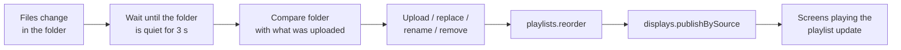

# Folder sync for digital signage

Manage what plays on your screens by managing a folder. Drop an image or video into a local folder
and it appears on every screen playing the playlist. Rename it to change the play order. Delete it
and it comes off the screens.

It is a small local Node.js app built on the [EasySignage](https://www.easysignage.com) Open API
and the official [`@easysignage/sdk`](https://www.npmjs.com/package/@easysignage/sdk). EasySignage
works here as a **headless CMS**: the folder is the source of truth, and EasySignage stores the
content and delivers it to the screens.

> **Blog post:** [Digital Signage Folder Sync: Update Screens by Dropping Files in a Folder](https://easysignage.com/blog/26/sync-folder-to-digital-signage/) explains the use case, who it is for and how to roll it out.

## What it does

| You do this in the folder | The app does this | API call |
| --- | --- | --- |
| Add a file | Uploads it into the playlist | `media.uploadFile(path, { playlist })` |
| Overwrite a file with new content | Uploads the new version, then removes the old one | `media.uploadFile`, then `media.delete` |
| Rename a file | Keeps the same media item and moves it; no new upload | `media.update` (name) |
| Delete a file | Removes it from the playlist | `media.delete`, or `playlists.unassignMedia` |
| *(after every batch)* | Sets the play order from the file names, then publishes once | `playlists.reorder`, then `displays.publishBySource` |

**Play order follows the file names** in natural order, so `01-welcome.png`, `02-menu.png` and
`10-hours.png` play in that order. Use number prefixes to arrange your content.

The UI shows the watched folder, each file with its thumbnail and status (queued, uploading,
stored, published or error), and an API log of each SDK call with its HTTP route and response.

## How it works



The core of the app is simple:

```ts
import { EasySignage } from "@easysignage/sdk";

const client = new EasySignage(); // reads EASYSIGNAGE_API_KEY from the environment

// A new file in the folder becomes a new item in the playlist...
const media = await client.media.uploadFile("./content/02-menu.png", { playlist: playlistId, duration: 10 });

// ...and one publish updates every screen whose content is that playlist.
await client.displays.publishBySource(playlistId);
```

The rest of [`src/sync.ts`](src/sync.ts) handles what real folders do:

- **Batching.** Dragging in 10 files produces 10 uploads but only **one** reorder and **one**
  publish. The app waits until the folder has been quiet for `DEBOUNCE_MS` (3 seconds by default).
- **Half-copied files.** A file is only picked up once it has stopped growing, so a large video
  isn't uploaded while it is still being copied.
- **Renames without re-uploading.** A file whose content matches one that has just disappeared is
  treated as a rename.
- **No gaps on screen.** When a file changes, the new version is uploaded before the old one is
  removed.
- **Catching up after a restart.** On startup the app compares the folder with what it uploaded
  before (kept in `.sync-state.json`) and applies anything that changed while it was off. If an
  item was deleted by hand in the CMS, the file is uploaded again.
- **Your other content is left alone.** The app only removes media it uploaded itself (recorded in
  `.sync-state.json` and tagged `folder-sync`). Items added to the playlist by hand stay where they are.
- **Junk files are ignored.** Hidden files, `.DS_Store`, Office lock files (`~$…`), partial
  downloads and unsupported types are skipped.

Supported files: **PNG, JPG, GIF, WebP** images and **MP4, MOV, WebM, M4V** videos. Images play for
`DEFAULT_DURATION` seconds; videos play for their own length. SVG is not accepted by the API.

## Requirements

- **Node.js 20.12 or newer** (`node -v` to check)
- **An EasySignage account on a Premium or Enterprise plan** (API access)
- **An API key** with permissions for **media**, **playlists** and **displays**
- **At least one screen** registered in your account. A browser player works fine for testing.

## Setup

### 1. Get the code and install

```bash
git clone https://github.com/easysignage/Digital-Signage-Folder-Sync.git
cd Digital-Signage-Folder-Sync
npm install
```

### 2. Create an API key

In the CMS at [app.easysignage.com](https://app.easysignage.com/), go to **Settings → API Keys**
and create a key with the **media**, **playlists** and **displays** permissions. The key is shown
only once, so copy it straight away.

### 3. Add the key to `.env`

```bash
cp .env.example .env
```

Open `.env` and set the key:

```
EASYSIGNAGE_API_KEY=ds_api_your_key_here
```

`.env` is listed in `.gitignore`, so it is never committed. Keep the key out of source code,
screenshots and issue reports. See [Keeping your API key safe](#keeping-your-api-key-safe).

### 4. Tag your screens

In the CMS, add the tag **`automation`** to each screen that should show the folder's content. To
use a different tag, change `SCREEN_TAG` in `.env`.

### 5. Create the playlist and assign it to the screens

```bash
npm run setup
```

This is safe to run more than once. It:

1. uses `PLAYLIST_ID` from `.env` if it is set; otherwise it finds or creates a playlist called
   **"Folder sync demo"** and writes its id into `.env`,
2. assigns the playlist **directly** to every screen tagged `automation` and publishes them.

> **Why "directly" matters:** `publishBySource` updates the screens whose content source *is* this
> playlist. A screen that gets the playlist through a group, channel or schedule has a different
> source, so it isn't included. To use your own playlist, set `PLAYLIST_ID` in `.env` and make sure
> your screens are assigned that playlist directly.

### 6. Run

```bash
npm run dev
```

Open **http://localhost:3001**, click **Open folder**, and drag a few files from
[`samples/`](samples) into it. After about 3 seconds the app uploads them and publishes, and the
screens update.

## Using the demo

| Control | What it does |
| --- | --- |
| **Open folder** | Opens the watched folder in Finder / Explorer / your file manager |
| **Sync now** | Compares the folder with the playlist straight away and publishes, without waiting for the batch timer |
| **Reset** | Removes every item this app uploaded and publishes the emptied playlist. **Files in the folder are not touched**, so empty the folder too if you want a clean start. |

Things to try:

1. Drag in `01-welcome.png` and `02-menu.png`. You get two uploads and one publish.
2. Rename `02-menu.png` to `00-menu.png`. It moves to the front, without being uploaded again.
3. Save a new version of a file over the old one. The new version replaces it on screen.
4. Delete a file. It comes off the screens.
5. Stop the app, change some files, then start it again. It catches up on startup.

## Configuration

All settings live in `.env`. See [`.env.example`](.env.example).

| Variable | Default | Description |
| --- | --- | --- |
| `EASYSIGNAGE_API_KEY` | *(required)* | Your API key |
| `EASYSIGNAGE_BASE_URL` | `https://api.easysignage.io` | Only for white-label accounts that use their own API host |
| `PLAYLIST_ID` | *(set by `npm run setup`)* | The playlist the folder is mirrored into |
| `SCREEN_TAG` | `automation` | `npm run setup` assigns the playlist to screens with this tag |
| `WATCH_DIR` | `./content` | The folder to watch. Only top-level files are synced; subfolders are ignored. |
| `DEFAULT_DURATION` | `10` | Seconds each image is shown |
| `DEBOUNCE_MS` | `3000` | How long the folder must be quiet before a batch syncs |
| `DELETE_MODE` | `delete` | `delete` removes a deleted file's media from the account. `unassign` only takes it out of the playlist and keeps it in the media library. |
| `PORT` | `3001` | Port for the local web UI |

## Scripts

| Command | What it does |
| --- | --- |
| `npm run dev` | Starts the app and restarts it when the code changes |
| `npm start` | Starts the app |
| `npm run setup` | Creates or finds the playlist, saves `PLAYLIST_ID` and assigns the playlist to your tagged screens |
| `npm run reset` | Removes everything the app uploaded and publishes, without starting the UI |
| `npm test` | Runs the unit tests for the sync rules |
| `npm run typecheck` | Type-checks the project |

## Project structure

```
src/
  server.ts       Express server: UI, local API, thumbnails and live event stream
  watcher.ts      Watches the folder (chokidar), and waits for files to finish copying
  sync.ts         Batching, applying changes, reorder, publish, reset
  plan.ts         Works out what to change (upload, replace, rename, remove) without any API calls
  files.ts        Supported file types, natural sort order, hashing
  manifest.ts     Reads and writes .sync-state.json (file → media item)
  easysignage.ts  SDK client, plus a wrapper that logs every call and its HTTP routes
  config.ts       Reads and validates .env
  log.ts          Event bus behind the live log (Server-Sent Events)
public/index.html The UI (plain HTML and JavaScript, no build step)
scripts/          setup and reset
samples/          Demo images to drag into the folder
content/          The default watched folder (its contents are git-ignored)
test/             Unit tests
```

## Taking it further

- **Point it at a shared folder.** Set `WATCH_DIR` to a Dropbox, OneDrive, Google Drive or network
  folder, and anyone who can drop a file there can update the screens, without a CMS login.
- **One folder per location.** Run one instance per playlist, each with its own `.env`, `WATCH_DIR`
  and `PORT`.
- **Run it unattended.** `npm start` runs it as a normal Node.js process. Keep it running with a
  process manager such as pm2 or systemd, or as a Windows service.
- **Use another source.** `plan.ts` only needs a list of `{ name, hash, size }`, so the same
  logic works for an S3 bucket, a CMS export or a product feed.

## Troubleshooting

| What you see | Cause and fix |
| --- | --- |
| `PLAYLIST_ID is not set` | Run `npm run setup`, or set `PLAYLIST_ID` in `.env` yourself. |
| `No screens are playing this playlist` (`publish_no_players`) | No screen has this playlist as its **direct** source. Run `npm run setup`, or assign the playlist directly to a screen. Assigning it through a group or channel doesn't count. |
| A file shows **error** | The reason is shown under the file name and in the log. Fix it, then save the file again or click **Sync now**; failed files are retried on every sync. |
| A file never shows up | Check that it is a supported type at the top level of the folder (not in a subfolder), and not a hidden or temporary file. |
| A video takes a while to appear | The upload finishes once the file is stored, but EasySignage may still be processing a long video. Short clips and images appear fastest. |
| `403` on every call | The key is wrong or revoked, lacks a permission, or the plan has no API access. Check the key's permissions under **Settings → API Keys**. |
| Everything gets uploaded again | `.sync-state.json` was deleted, or `PLAYLIST_ID` changed. The file links uploads to a specific playlist. |

## Keeping your API key safe

- The key gives full access to your account's data and **does not expire**. Treat it like a password.
- Keep it in `.env` only. `.env` and `.sync-state.json` are ignored by git, and `.env.example`
  contains no real values.
- The key is used only by the local Node.js server. The browser UI never sees it, and the server
  listens on `127.0.0.1` only. The SDK also refuses to run in a browser.
- Give the key only the permissions this demo needs (media, playlists, displays).
- If a key leaks, delete it under **Settings → API Keys** and create a new one.

## Links

- Blog post: [Digital Signage Folder Sync: Update Screens by Dropping Files in a Folder](https://easysignage.com/blog/26/sync-folder-to-digital-signage/)
- Open API overview: [How to Automate Digital Signage with EasySignage Open API](https://easysignage.com/blog/26/digital-signage-api-integration/)
- Creating an API key: [API Keys help article](https://easysignage.com/help/account-settings/digital-signage-api-keys/). The full API reference opens from the CMS under **Settings → API Keys → Open API Docs**.
- SDK: [`@easysignage/sdk` on npm](https://www.npmjs.com/package/@easysignage/sdk)
- Companion demo: [Digital-Signage-Sales-driven-promotions](https://github.com/easysignage/Digital-Signage-Sales-driven-promotions),
  which turns a promotion on and off across screens from a sales number

## License

[MIT](LICENSE)
